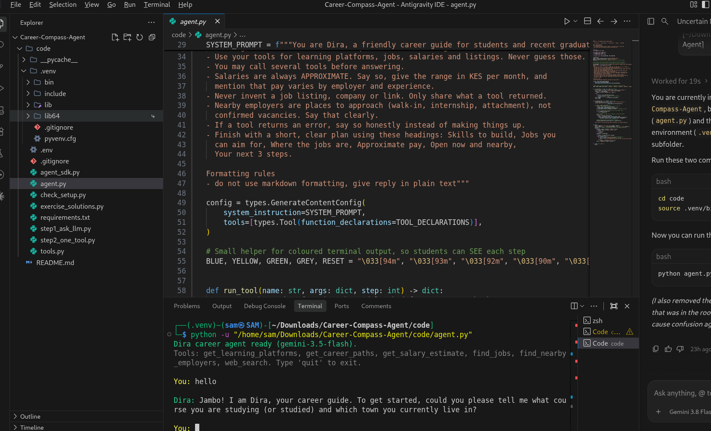
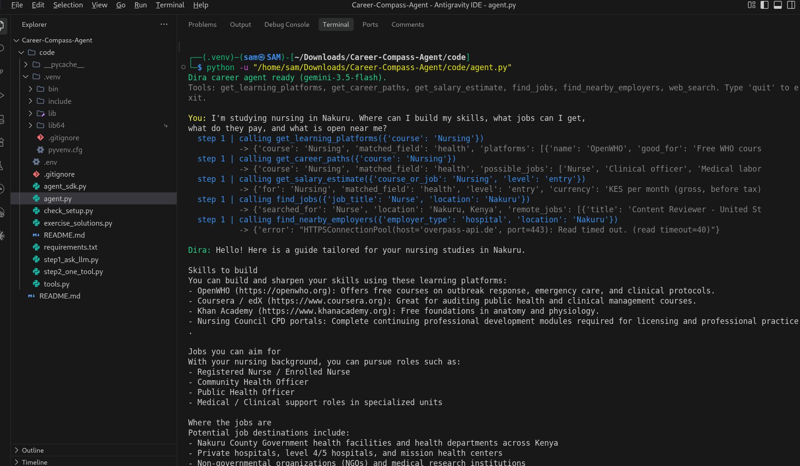
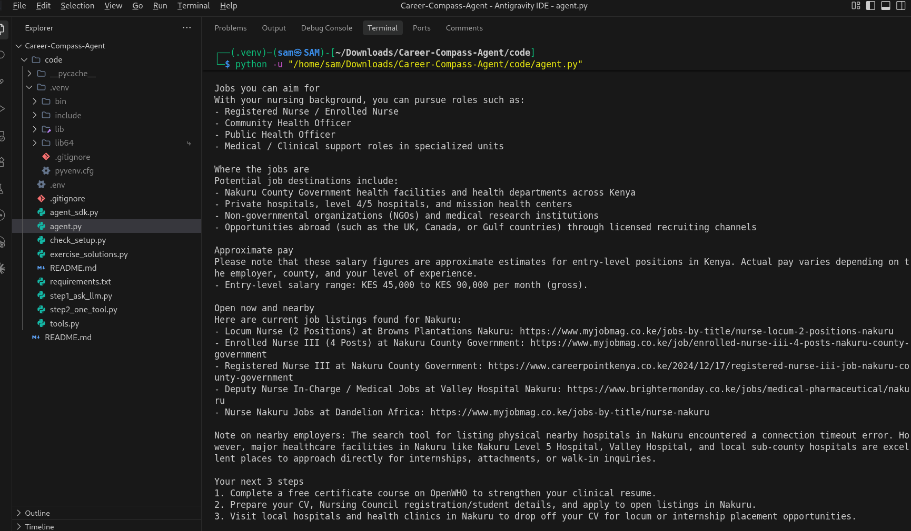

# Dira: Career Compass Agent

[](https://www.python.org/)
[](#)

Dira is an AI-powered career assistant for students and recent graduates in Kenya. Given a student's course and location, Dira creates a practical plan that highlights:

- Platforms and resources for building relevant skills
- Suitable career paths and job destinations
- Estimated monthly salaries in Kenyan shillings (KES)
- Live job opportunities and nearby real employers for internships or attachments

The LLM never invents jobs or salaries. It asks Python code to call tools, reads the results, and writes the final plan. A safety limit (`MAX_STEPS = 8`) prevents runaway tool loops.

## Demo

The screenshots below show Dira exploring career options, jobs, and nearby opportunities.

| Career guidance | Job opportunities | Nearby employers |
|---|---|---|
|  |  |  |

## Tech Stack

| Layer | Technology |
|---|---|
| Language | Python 3 |
| LLM | Google Gemini (default `gemini-3.5-flash`, configurable) |
| LLM SDK | `google-genai` (function calling / tool use) |
| HTTP | `requests` |
| Config | `python-dotenv` (`.env` file) |
| Remote jobs | [Remotive API](https://remotive.com/api/remote-jobs) |
| Kenyan job boards and web verification (optional) | [Tavily Search API](https://tavily.com) |
| Nearby employers | [OpenStreetMap](https://www.openstreetmap.org) via the Overpass API |
| Geocoding | Open-Meteo Geocoding API |
| Extra exercise tool | REST Countries API |

### Agent Architecture

Dira uses the classic **think → act → observe** loop:

1. The student asks a question.
2. Gemini decides which tool(s) to call.
3. Python runs the matching function and returns the result.
4. Gemini reads the results and either calls more tools or writes the final answer.
5. The safety limit (`MAX_STEPS = 8`) stops runaway loops.

---

## Features and Tools

| Tool | Data source | Purpose |
|---|---|---|
| `get_learning_platforms` | Built-in knowledge base | Where to build skills for a course |
| `get_career_paths` | Built-in knowledge base | Jobs and career destinations |
| `get_salary_estimate` | Built-in knowledge base | Approximate monthly pay (Kenya, KES) |
| `find_jobs` | Remotive + job-board links (+ Tavily) | Current job listings |
| `find_nearby_employers` | OpenStreetMap (Overpass) | Closest real employers, nearest first |
| `web_search` | Tavily (optional) | Verify pay, deadlines, and news |

The built-in knowledge base covers career fields such as software/IT, data and AI, cybersecurity, business and marketing, accounting and finance, and engineering. Courses are matched to fields by keyword.

## Project Structure

```text
├── agent.py                 # Full agent loop (think → act → observe)
├── agent_sdk.py             # Same agent using Gemini SDK tool loop
├── tools.py                 # Tools, knowledge base, and declarations
├── step1_ask_llm.py         # Demo: a plain LLM guessing about jobs and pay
├── step2_one_tool.py        # Demo: one tool, one round trip
├── exercise_solutions.py    # Extra tools: country facts, saved plans, skills gaps
├── check_setup.py           # Verify environment and API keys
├── requirements.txt         # Python dependencies
├── docs/images/             # README screenshots and demo images
└── .gitignore
```

## Getting Started

### Prerequisites

- Python 3.10 or newer
- A free [Gemini API key](https://aistudio.google.com/apikey)
- *(Optional)* A free [Tavily API key](https://app.tavily.com) for `web_search` and live Kenyan job-board results

### Installation

```bash
git clone https://github.com/254ochola-max/Dira.git
cd Dira

# Recommended: create a virtual environment
python -m venv .venv
source .venv/bin/activate          # Windows: .venv\Scripts\activate

# Install dependencies
pip install -r requirements.txt
```

### Configuration

Create `.env` in the project root:

```env
GEMINI_API_KEY=your_gemini_key_here

# Optional: enables web_search and live Kenyan job-board results
TAVILY_API_KEY=

# Optional: switches models if you hit free-tier limits
GEMINI_MODEL=gemini-3.5-flash
```

> **Never commit your `.env` file.** It is already listed in `.gitignore`.

### Verify Your Setup

```bash
python check_setup.py
```

### Run Dira

```bash
python agent.py
```

For the Gemini SDK-managed tool loop:

```bash
python agent_sdk.py
```

### Example Prompt

```text
I'm studying nursing in Nakuru. Where can I build my skills, what jobs can I get,
what do they pay, and what is open near me?
```

Dira organizes answers into: **Skills to build, Jobs to aim for, Where the jobs are, Approximate pay, Opportunities open now, and Your next 3 steps.**

## Learning Path

The repository doubles as a small tutorial for building agents:

1. `step1_ask_llm.py`: see how a plain LLM guesses about live jobs and pay.
2. `step2_one_tool.py`: give the LLM one tool and complete one round trip.
3. `agent.py`: build the complete multi-tool agent loop.
4. `agent_sdk.py`: implement the same agent with the Gemini SDK's built-in loop.
5. `exercise_solutions.py`: add extra tools and extend the agent.

## Limitations

- **Salary bands are starter estimates**, not official statistics. Replace them with trusted, current data before making decisions.
- **Platforms and job-board URLs can change.** Spot-check links before sharing.
- **Nearby employers come from OpenStreetMap volunteers.** They are places to approach, not confirmed vacancies.
- **Remote jobs come from Remotive**; keep the source link with every result.
- **Live Kenyan job-board results require a Tavily key.** Without it, Dira provides general search links instead.

## Contributing

Contributions are welcome. A good place to start is to add a new career field to the `FIELDS` knowledge base in `tools.py`, which upgrades the whole agent at once.

1. Fork the repository
2. Create a feature branch (`git checkout -b feature/new-field`)
3. Commit your changes
4. Open a pull request

## Acknowledgments

- [Google Gemini](https://ai.google.dev) for the LLM
- [Remotive](https://remotive.com) for remote job listings
- [OpenStreetMap](https://www.openstreetmap.org) contributors for employer data
- [Tavily](https://tavily.com) for web search
- [Open-Meteo](https://open-meteo.com) for geocoding
